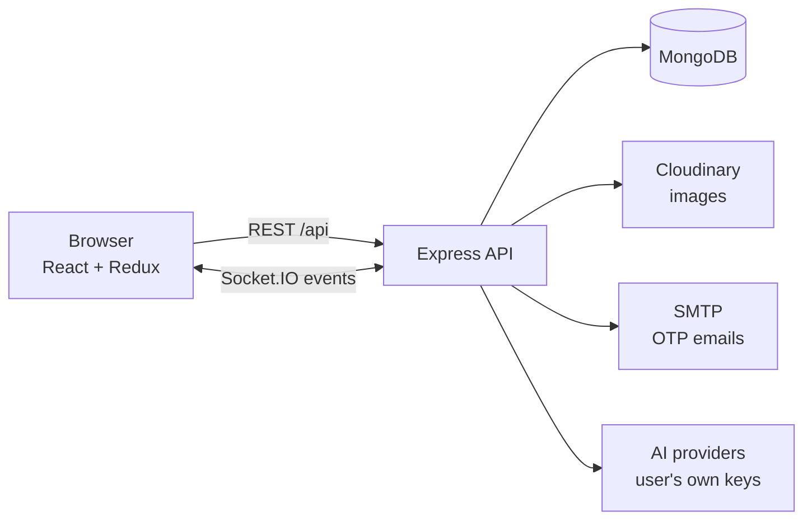

# Quick Chat

[](https://github.com/Agni-glitch/node-chat-application/actions/workflows/ci.yml)
[](LICENSE)

[](CONTRIBUTING.md)

A real-time chat app for direct and group conversations, with messages that disappear once
they've been read. Built with **MongoDB, Express, React, Redux Toolkit and Socket.IO**.


| Dark mode | Mobile |
| --- | --- |
|  |  |

## Contents

- [Features](#features)
- [Architecture](#architecture)
- [Quick start](#quick-start)
- [Configuration](#configuration)
- [Scripts](#scripts)
- [Deployment](#deployment)
- [Contributing](#contributing)
- [Documentation](#documentation)

## Features

**Messaging**
- Real-time direct and **group chats** over Socket.IO, with resync after reconnecting
- Read receipts ("Seen by 1 of 2 → everyone"), unread badges (also in the tab title) and typing indicators
- Online presence across multiple tabs and devices
- Photo messages and profile pictures (stored in Cloudinary), lazy-loaded emoji picker, multi-line messages (Shift + Enter)
- Group admin controls: rename, add and remove members. Anyone can leave, and the admin role passes on automatically.

**Disappearing messages**
- A seen message is permanently deleted 2 minutes after it's read, with a live countdown
- In groups, the timer starts once **every** member has seen it
- Closing a chat deletes everything in it that has already been seen

**Bring-your-own AI models**
- Add chat or image models from OpenAI, Anthropic, Google Gemini, or any OpenAI-compatible API (OpenRouter, Groq, Together, Ollama…) under a custom name
- Chat with a model privately, or call it in any conversation with `@Name`, like `@Alen what's a good pizza place?`
- Keys are encrypted at rest and only the owner can call their models. AI replies disappear like any other seen message.

**Accounts and security**
- Email verification and password reset by 6-digit code (OTP); a reset signs the account out everywhere
- Profile links (Instagram, X, Facebook, LinkedIn, GitHub, YouTube, TikTok, website), each checked against the platform's domain
- Authenticated sockets, per-chat authorization, Helmet + CSP, CORS allow-list, rate limiting, input validation,
  SSRF-safe AI requests, and generic auth errors so login can't be used to discover accounts

## Architecture



- Messages are **sent over REST** and **delivered over Socket.IO** to each member's personal room.
- A background sweeper (plus MongoDB TTL indexes) deletes seen messages and tells clients which ones disappeared.
- The server can serve the React build itself (one service), or the client can be hosted separately, for example on Vercel.

More detail for contributors is in [docs/ARCHITECTURE.md](docs/ARCHITECTURE.md).

```
.
├── client/                 React app (Create React App)
│   ├── scripts/            Build-time checks (e.g. check-env.js for Vercel)
│   └── src/
│       ├── apiCalls/       Axios instance + REST calls
│       ├── components/     Shared UI (Avatar, Modal, AuthLayout, ProtectedRoute…)
│       ├── hooks/          useChatSocket (realtime events), useLogout
│       ├── pages/          home, login, signup, verify-email, forgot-password, profile, models
│       ├── redux/          Store + user/chat/message slice
│       └── utils/          Formatting and media helpers
├── server/                 Express API + Socket.IO
│   ├── config/             Env validation, MongoDB connection
│   ├── controllers/        auth, user, chat, message, bot routers
│   ├── middlewares/        JWT auth, error handling
│   ├── model/              Mongoose models
│   ├── services/           Disappearing-message sweeper, group read receipts, AI providers + @mentions
│   ├── utils/              OTP, mailer, validation, CORS origins, social links, key encryption, SSRF-safe HTTP
│   ├── socket.js           Socket.IO auth, presence, typing, emit helpers
│   └── tests/              API and unit tests (node:test)
├── docs/                   Architecture, API reference, deployment guide, screenshots
├── vercel.json             Vercel config for the client
├── render.yaml             Render Blueprint for the API
└── Dockerfile              Single-image production build (API + client)
```

## Quick start

**You need:** Node.js 22 or newer (see [.nvmrc](.nvmrc)) and a MongoDB database, either local or a free
[Atlas](https://www.mongodb.com/atlas) cluster. SMTP and Cloudinary are optional in development.

```bash
git clone https://github.com/Agni-glitch/node-chat-application.git
cd node-chat-application

# 1. Install dependencies for both apps
npm run install:all

# 2. Configure the server: set MONGODB_URI and JWT_SECRET at minimum
cp server/.env.example server/.env

# 3. Optional: configure the client (defaults to http://localhost:5000)
cp client/.env.example client/.env.local

# 4. Run both, in two terminals
npm run dev:server     # API on http://localhost:5000
npm run dev:client     # UI  on http://localhost:3000
```

> **No SMTP in development?** Leave `SMTP_HOST` empty and the server prints every verification and
> password-reset email, including the code, to its console.
>
> **No MongoDB installed?** `docker run -d -p 27017:27017 mongo:7`, then use
> `MONGODB_URI=mongodb://127.0.0.1:27017/quick-chat`.

## Configuration

Every setting is documented inline in [server/.env.example](server/.env.example) and
[client/.env.example](client/.env.example). The ones you'll touch most:

### Server: `server/.env`

| Variable | Required | Default | Description |
| --- | --- | --- | --- |
| `MONGODB_URI` | ✅ | | MongoDB connection string |
| `JWT_SECRET` | ✅ | | Token signing secret (≥ 32 chars in production) |
| `NODE_ENV` | | `development` | `production` enables strict checks and hides internal errors |
| `PORT` | | `5000` | HTTP port (most hosts set this for you) |
| `CLIENT_URL` | prod* | `http://localhost:3000` | Comma-separated allowed origins. `*` is allowed in one hostname label for preview deploys, e.g. `https://quick-chat-*-team.vercel.app` (*not needed with `SERVE_CLIENT=true`) |
| `SERVE_CLIENT` | | `false` | Serve `client/build` from the API server (single-service deploy) |
| `SMTP_HOST` | prod | | SMTP server for OTP emails (console fallback in dev) |
| `SMTP_PORT` / `SMTP_SECURE` / `SMTP_USER` / `SMTP_PASS` | | `587` / `false` | SMTP connection |
| `MAIL_FROM` | | `Quick Chat <no-reply@localhost>` | Sender address |
| `CLOUDINARY_CLOUD_NAME` / `_API_KEY` / `_API_SECRET` | | | Enable image uploads |
| `AI_KEYS_SECRET` | prod (for AI) | dev fallback | Encrypts users' AI provider keys (≥ 32 chars) |
| `MONGO_AUTO_INDEX` | | `false` | Build indexes on start in production (needed at least once) |
| `TRUST_PROXY` | | `1` in prod | Number of proxies in front of the app |

<details>
<summary>All other server settings</summary>

| Variable | Default | Description |
| --- | --- | --- |
| `JWT_EXPIRES_IN` | `1d` | Session length |
| `CLOUDINARY_FOLDER` | `chat-app` | Upload folder |
| `MAX_IMAGE_MB` | `5` | Max upload size |
| `OTP_TTL_MINUTES` | `10` | Code lifetime |
| `OTP_MAX_ATTEMPTS` | `5` | Wrong guesses before a code is burned |
| `OTP_RESEND_COOLDOWN_SECONDS` | `60` | Minimum gap between codes |
| `UNVERIFIED_ACCOUNT_TTL_HOURS` | `24` | Abandoned sign-ups are deleted after this |
| `EMAIL_MX_CHECK` | `true` | Reject domains that can't receive mail |
| `SEEN_MESSAGE_TTL_SECONDS` | `120` | Seen messages are deleted this long after being read |
| `MESSAGE_SWEEP_INTERVAL_SECONDS` | `15` | Cleanup job interval |
| `AI_MAX_OUTPUT_TOKENS` / `AI_MAX_REPLY_CHARS` | `800` / `500` | Keep AI replies short |
| `AI_REQUEST_TIMEOUT_SECONDS` | `90` | Provider request timeout |
| `AI_RATE_LIMIT_PER_MINUTE` | `20` | AI generations per user per minute |
| `AI_MAX_BOTS_PER_USER` | `10` | Models per user |
| `AI_HISTORY_MESSAGES` | `10` | Context messages in private AI chats |
| `ALLOW_PRIVATE_AI_ENDPOINTS` | `true` dev / `false` prod | Allow localhost/private base URLs (e.g. Ollama) |
| `GROUP_MAX_MEMBERS` | `50` | Maximum group size |
| `RATE_LIMIT_PER_MINUTE` | `300` | API requests per IP per minute |
| `AUTH_RATE_LIMIT` | `20` | Login/signup attempts per IP per 15 min |

</details>

### Client: `client/.env.local` (build time, public)

| Variable | Default | Description |
| --- | --- | --- |
| `REACT_APP_API_URL` | `http://localhost:5000` in dev, same origin in prod | API / socket server URL. **Required on Vercel.** |
| `REACT_APP_MAX_IMAGE_MB` | `5` | Client-side size check, keep in sync with `MAX_IMAGE_MB` |
| `GENERATE_SOURCEMAP` | | Set `false` for production |

`REACT_APP_*` values are baked into the JavaScript bundle and visible to anyone, so never put secrets there.

## Scripts

| Command (repo root) | Description |
| --- | --- |
| `npm run install:all` | Install server and client dependencies |
| `npm run dev:server` | API with auto-reload (nodemon) |
| `npm run dev:client` | React dev server |
| `npm test` | Server tests + client unit tests |
| `npm run build` | Install production deps and build the client |
| `npm start` | Start the API (serves the client when `SERVE_CLIENT=true`) |

## Deployment

The API keeps WebSocket connections open and runs a background cleanup job, so it needs a
**long-running Node host**. Vercel's serverless functions can't hold sockets, so the recommended
setup splits the app in two:

| Part | Host | Config in this repo |
| --- | --- | --- |
| React client | **Vercel** | [vercel.json](vercel.json) |
| API + Socket.IO | **Render** (or Railway, Fly.io, any VPS) | [render.yaml](render.yaml) |
| Database | MongoDB Atlas | |

1. **Deploy the API on Render:** *New → Blueprint →* pick this repo, then fill in `MONGODB_URI`,
   SMTP and Cloudinary settings. Use a placeholder such as `https://example.com` for `CLIENT_URL` for now.
   Copy the service URL.
2. **Deploy the client on Vercel:** *Add New → Project →* import this repo and keep the root directory as is
   (`vercel.json` sets the build). Add `REACT_APP_API_URL` = your Render URL and deploy.
3. **Allow the client origin:** set `CLIENT_URL` on Render to your Vercel URL, e.g.
   `https://quick-chat.vercel.app`, and redeploy the API.

Prefer one service? `npm run build` + `npm start` with `SERVE_CLIENT=true` runs everything on one host,
and the [Dockerfile](Dockerfile) does the same in a container.

**Read [docs/DEPLOYMENT.md](docs/DEPLOYMENT.md) before going live.** It covers secrets, indexes,
preview deployments, custom domains and the production checklist.

## Contributing

Contributions are welcome, from typo fixes to new features. Start with [CONTRIBUTING.md](CONTRIBUTING.md)
for setup, coding conventions and the pull request process, and look for issues labeled
[`good first issue`](https://github.com/Agni-glitch/node-chat-application/labels/good%20first%20issue).

Please follow the [Code of Conduct](CODE_OF_CONDUCT.md), and report security problems privately as described in
[SECURITY.md](SECURITY.md), not in public issues.

## Documentation

- [Architecture overview](docs/ARCHITECTURE.md)
- [API reference (REST + Socket.IO events)](docs/API.md)
- [Deployment guide](docs/DEPLOYMENT.md)
- [Contributing guide](CONTRIBUTING.md)
- [Changelog](CHANGELOG.md)

## License

[MIT](LICENSE) © Agni Roybar
