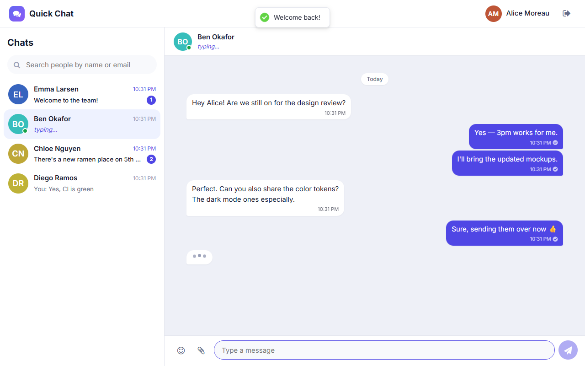
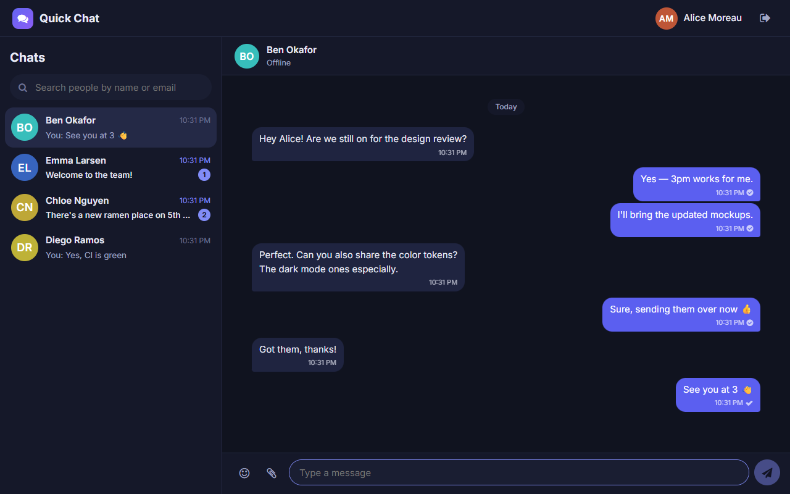
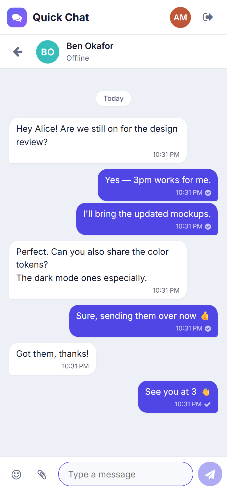

# Quick Chat

A real-time one-to-one chat app built with **MongoDB, Express, React, Redux Toolkit and Socket.IO**.



| Dark mode | Mobile |
| --- | --- |
|  |  |

## Features

- Email/password accounts with **email verification by 6-digit code (OTP)**; only verified addresses can use the app
- **Forgot password** via emailed code; a reset signs the account out everywhere
- **Disappearing messages**: a seen message is permanently deleted 2 minutes after it's read
  (with a live countdown), and every seen message in a chat is deleted as soon as either member closes it
- **Profile links** (Instagram, X/Twitter, Facebook, LinkedIn, GitHub, YouTube, TikTok, website), each checked against the platform's domain and shown in a contact panel
- **Bring-your-own AI models**: add chat or image models (OpenAI, Anthropic, Google Gemini, or any
  OpenAI-compatible API such as OpenRouter, Groq, Together or Ollama) under a custom name. Chat with a model
  privately, or call it inside any conversation with `@Name`, like `@Alen what's a good pizza place?`.
  Replies are short, generated images can be opened in a new tab or downloaded, and every AI output
  disappears like other seen messages. Keys are encrypted at rest, and only the owner can call their models.
- **Group chats** with the same rules: a message disappears 2 minutes after **every** member has seen it,
  and closing the group deletes everything the group has seen. Per-member unread badges, "Ben is typing…",
  sender names, "Seen by 1 of 2 → everyone" ticks, `@mentions` of your AI models, and admin controls
  (rename, add/remove members). Anyone can leave, and the admin role passes on automatically.
- Real-time messaging over Socket.IO, with resync after reconnecting
- Read receipts, unread badges (also shown in the browser tab title) and typing indicators
- Online presence that tracks multiple tabs and devices
- Photo messages and profile pictures (stored in Cloudinary)
- Emoji picker (lazy-loaded), multi-line messages (Shift + Enter)
- People search by name or email
- Responsive layout with automatic light and dark themes
- Security hardening: authenticated sockets, per-chat authorization, Helmet + CSP,
  CORS allow-list, rate limiting, input validation, and generic auth errors so login can't be used to discover accounts

## Project structure

```
.
├── client/                 React app (Create React App)
│   └── src/
│       ├── apiCalls/       Axios instance + REST calls
│       ├── components/     Shared UI (Avatar, Loader, AuthLayout, ProtectedRoute)
│       ├── hooks/          useChatSocket (realtime events), useLogout
│       ├── pages/          home, login, signup, profile
│       ├── redux/          Store + user/chat/message slice
│       └── utils/          Formatting helpers
├── server/                 Express API + Socket.IO
│   ├── config/             Env validation, MongoDB connection
│   ├── controllers/        auth, user, chat, message routers
│   ├── middlewares/        JWT auth, error handling
│   ├── model/              Mongoose models
│   ├── services/           messageCleanup (disappearing-message sweeper), ai/ (providers + @mentions)
│   ├── utils/              OTP, mailer, validation, social-link rules, key encryption, SSRF-safe HTTP
│   ├── socket.js           Socket.IO auth, presence, typing, emit helpers
│   └── tests/              API regression tests (node:test)
├── docs/                   API reference, deployment guide, screenshots
└── Dockerfile              Single-image production build
```

## Getting started

**Prerequisites:** Node.js ≥ 18.18, a MongoDB database (local or [Atlas](https://www.mongodb.com/atlas)), an SMTP account for verification emails (optional in development), and optionally a [Cloudinary](https://cloudinary.com) account for image uploads.

> **No SMTP in development?** Leave `SMTP_HOST` empty and the server prints every
> verification/reset email, including the code, to its console.

```bash
# 1. Install dependencies
npm run install:all

# 2. Configure the server
cp server/.env.example server/.env      # then fill in MONGODB_URI, JWT_SECRET, Cloudinary keys

# 3. (Optional) configure the client: defaults to http://localhost:5000
cp client/.env.example client/.env.local

# 4. Run both (two terminals)
npm run dev:server     # API on http://localhost:5000
npm run dev:client     # UI  on http://localhost:3000
```

## Environment variables

### Server: `server/.env`

| Variable | Required | Default | Description |
| --- | --- | --- | --- |
| `MONGODB_URI` | ✅ | | MongoDB connection string |
| `JWT_SECRET` | ✅ | | Token signing secret (≥ 32 chars in production) |
| `NODE_ENV` | | `development` | `production` enables strict checks and hides internal errors |
| `PORT` | | `5000` | HTTP port |
| `JWT_EXPIRES_IN` | | `1d` | Session length |
| `CLIENT_URL` | prod* | `http://localhost:3000` | Comma-separated allowed origins (*not needed with `SERVE_CLIENT=true`) |
| `SERVE_CLIENT` | | `false` | Serve `client/build` from the API server |
| `TRUST_PROXY` | | `1` in prod | Number of proxies in front of the app |
| `CLOUDINARY_CLOUD_NAME` / `_API_KEY` / `_API_SECRET` | | | Enable image uploads |
| `CLOUDINARY_FOLDER` | | `chat-app` | Upload folder |
| `MAX_IMAGE_MB` | | `5` | Max upload size |
| `SMTP_HOST` | prod | | SMTP server for OTP emails (console fallback in dev) |
| `SMTP_PORT` / `SMTP_SECURE` | | `587` / `false` | `465` + `true` for implicit TLS |
| `SMTP_USER` / `SMTP_PASS` | | | SMTP credentials |
| `MAIL_FROM` | | `Quick Chat <no-reply@localhost>` | Sender address |
| `OTP_TTL_MINUTES` | | `10` | Code lifetime |
| `OTP_MAX_ATTEMPTS` | | `5` | Wrong guesses before a code is burned |
| `OTP_RESEND_COOLDOWN_SECONDS` | | `60` | Minimum gap between codes |
| `UNVERIFIED_ACCOUNT_TTL_HOURS` | | `24` | Abandoned sign-ups are deleted after this |
| `EMAIL_MX_CHECK` | | `true` | Reject domains that can't receive mail |
| `SEEN_MESSAGE_TTL_SECONDS` | | `120` | Seen messages are deleted this long after being read |
| `MESSAGE_SWEEP_INTERVAL_SECONDS` | | `15` | Cleanup job interval |
| `AI_KEYS_SECRET` | prod (for AI) | dev fallback | Encrypts users' AI provider keys (≥ 32 chars) |
| `AI_MAX_OUTPUT_TOKENS` / `AI_MAX_REPLY_CHARS` | | `800` / `500` | Keep AI replies short |
| `AI_REQUEST_TIMEOUT_SECONDS` | | `90` | Provider request timeout |
| `AI_RATE_LIMIT_PER_MINUTE` | | `20` | AI generations per user per minute |
| `AI_MAX_BOTS_PER_USER` | | `10` | Models per user |
| `AI_HISTORY_MESSAGES` | | `10` | Context messages in private AI chats |
| `ALLOW_PRIVATE_AI_ENDPOINTS` | | `true` dev / `false` prod | Allow localhost/private base URLs (e.g. Ollama) |
| `GROUP_MAX_MEMBERS` | | `50` | Maximum group size |
| `MONGO_AUTO_INDEX` | | `false` | Build indexes on start in production |
| `RATE_LIMIT_PER_MINUTE` | | `300` | API requests per IP per minute |
| `AUTH_RATE_LIMIT` | | `20` | Login/signup attempts per IP per 15 min |

### Client: `client/.env.local` (build time, public)

| Variable | Default | Description |
| --- | --- | --- |
| `REACT_APP_API_URL` | `http://localhost:5000` in dev, same origin in prod | API / socket server URL |
| `REACT_APP_MAX_IMAGE_MB` | `5` | Client-side size check |
| `GENERATE_SOURCEMAP` | | Set `false` for production |

See [server/.env.example](server/.env.example) and [client/.env.example](client/.env.example).

## Scripts

| Command (repo root) | Description |
| --- | --- |
| `npm run install:all` | Install server and client dependencies |
| `npm run dev:server` | API with auto-reload (nodemon) |
| `npm run dev:client` | React dev server |
| `npm run build` | Install production deps and build the client |
| `npm start` | Start the API (serves the client when `SERVE_CLIENT=true`) |
| `npm test` | Server API tests + client unit tests |

## Deployment

Short version (single service, e.g. Render):

- Build command: `npm run build`
- Start command: `npm start`
- Health check: `/api/health`
- Env: `NODE_ENV=production`, `SERVE_CLIENT=true`, `MONGODB_URI`, `JWT_SECRET`, `AI_KEYS_SECRET`, SMTP settings, Cloudinary keys

Or use Docker: `docker build -t quick-chat . && docker run -p 5000:5000 --env-file server/.env quick-chat`.

**Read [docs/DEPLOYMENT.md](docs/DEPLOYMENT.md) before going live.** It covers rotating
previously committed credentials, the one-time unique email index, split deployments and scaling.

## Documentation

- [API reference (REST + Socket.IO events)](docs/API.md)
- [Deployment guide](docs/DEPLOYMENT.md)
- [Changelog](CHANGELOG.md)

## License

[MIT](LICENSE) © Agni Roybar
