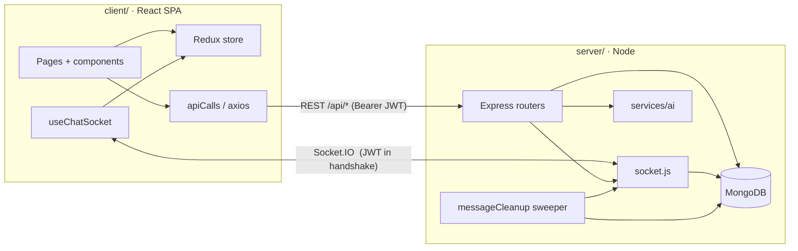
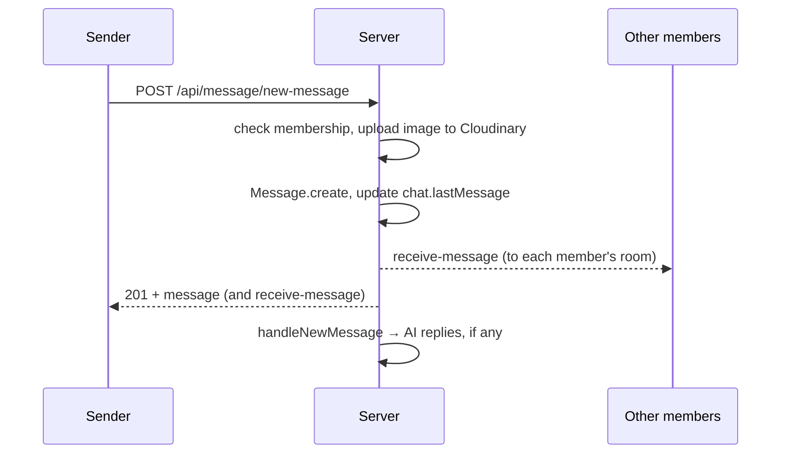

# Architecture

A map of how Quick Chat fits together, for anyone about to change it. For endpoint and event
details see [API.md](API.md); for hosting see [DEPLOYMENT.md](DEPLOYMENT.md).

## Overview

There is one Node process. It serves the REST API, the Socket.IO server and, optionally, the React build.
Online presence and socket rooms live in that process's memory (see [Scaling](DEPLOYMENT.md#scaling-notes)).

## Request lifecycle

1. The client keeps the JWT in `localStorage` and sends it as `Authorization: Bearer …`
   ([client/src/apiCalls/index.js](../client/src/apiCalls/index.js)).
2. [authmiddleware.js](../server/middlewares/authmiddleware.js) verifies the token **and** checks the
   account still exists, is verified, and that `tokenVersion` matches. Bumping `tokenVersion` (password
   reset) logs out every session.
3. Routers in [server/controllers/](../server/controllers/) validate input, always take the user id from
   the token (never the body), and check chat membership on every chat-scoped query.
4. Errors thrown in routes reach [errorHandler.js](../server/middlewares/errorHandler.js); in production,
   internal messages are hidden.

Every response has the shape `{ success, message, data }`, and the client's `request()` helper always resolves to it.

## Sending a message

Messages go **up over REST** and **down over Socket.IO**. Each socket joins a room named after its user id,
so `emitToUsers(memberIds, event, payload)` in [socket.js](../server/socket.js) reaches every tab and device.
After reconnecting, the client refetches chats and messages so nothing is missed.

## Read receipts and disappearing messages

- **Direct chats:** opening the chat calls `clear-unread-messages`, which sets `read: true, readAt: now`.
- **Groups:** each member who opens the chat is added to `readBy`.
  [groupReads.js](../server/services/groupReads.js) marks a message `read` only when every current member
  except the sender has seen it.
- **Deletion:** [messageCleanup.js](../server/services/messageCleanup.js) runs every
  `MESSAGE_SWEEP_INTERVAL_SECONDS` and deletes messages whose `readAt` is older than
  `SEEN_MESSAGE_TTL_SECONDS`. It fixes up `chat.lastMessage`, deletes Cloudinary images and emits
  `messages-deleted`. A MongoDB TTL index on `readAt` is a backstop in case the process is down.
- **Closing a chat** (`close-chat`) deletes all seen messages in it right away.

If you touch these paths, keep both mechanisms (sweeper and TTL index) agreeing on the same TTL.

## AI models

- Users store models in the `Bot` collection. API keys are encrypted with AES-256-GCM using
  `AI_KEYS_SECRET` ([utils/crypto.js](../server/utils/crypto.js)) and never returned to the browser.
- [services/ai/index.js](../server/services/ai/index.js) runs after a message is saved. It handles
  private AI chats and `@Name` mentions of **the sender's own** models, with a per-user rate limit and
  concurrency cap, and emits `ai-typing` / `ai-error`.
- [services/ai/providers.js](../server/services/ai/providers.js) talks to OpenAI, Anthropic, Gemini and
  OpenAI-compatible APIs. Custom base URLs go through [utils/net.js](../server/utils/net.js), which blocks
  private addresses at DNS lookup time in production (SSRF protection).
- AI replies are ordinary messages, so they disappear like everything else.

## Client state

- [redux/userSlice.js](../client/src/redux/userSlice.js) holds the current user, all chats, the selected
  chat and online users. Socket handlers dispatch into it, so components stay simple.
- [hooks/useChatSocket.js](../client/src/hooks/useChatSocket.js) owns every socket subscription.
  Add new realtime events there, not inside components.
- [config.js](../client/src/config.js) resolves the API URL: `REACT_APP_API_URL` if set, otherwise
  `localhost:5000` in development and the same origin in production.

## Adding things

| You want to… | Touch |
| --- | --- |
| Add an endpoint | A router in `server/controllers/`, validation in `server/utils/validation.js`, a call in `client/src/apiCalls/`, a test in `server/tests/`, and [API.md](API.md) |
| Add a realtime event | Emit with `emitToUsers` on the server, handle it in `useChatSocket.js`, and document it in [API.md](API.md) |
| Add a setting | `server/config/env.js`, `server/.env.example`, and the README table |
| Add an AI provider | `server/services/ai/providers.js` and the provider list in the models page |
